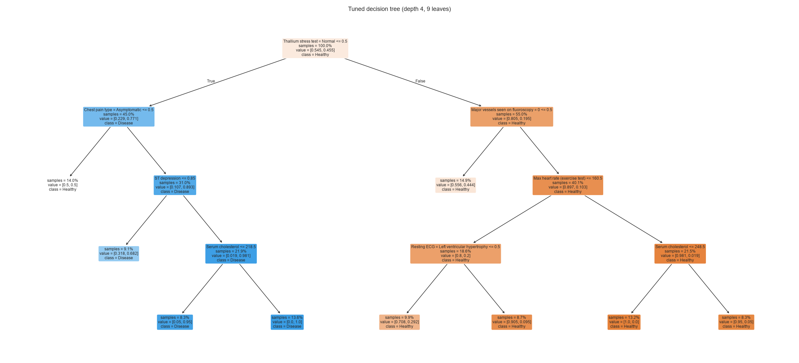

# Heart Disease Risk Predictor

Estimates the chance of coronary heart disease from 13 routine clinical measurements, using the classic UCI Cleveland patient data.

**[Live demo →](LIVE_DEMO_URL)** — fill in a patient profile (age, blood pressure, cholesterol, exercise-test results…) and get a probability instantly. The model runs in your browser (ONNX Runtime Web), no server needed.

> **Not medical advice.** This is a learning project trained on 303 patients from a 1988 study. It cannot diagnose anyone.



## Results

Held-out test set (20%, 61 patients):

| Metric | Score |
|---|---|
| ROC-AUC | **0.936** |
| Accuracy | 83.6% |
| Precision (disease) | 84.6% |
| Recall (disease) | 78.6% |
| F1 | 81.5% |

5×5 repeated stratified cross-validation on the training set (242 patients); the decision tree is tuned with `GridSearchCV` inside every fold (nested CV):

| Model | ROC-AUC | F1 | Accuracy |
|---|---|---|---|
| **Logistic Regression** (chosen) | 0.916 | 0.829 | 85.0% |
| Random Forest | 0.913 | 0.807 | 82.5% |
| Decision Tree (tuned) | 0.840 | 0.733 | 76.5% |

Logistic Regression and Random Forest are equally good, so I chose the simpler, more explainable one. The single tuned tree (best: depth 4, min 20 patients per leaf) is clearly weaker (test ROC-AUC 0.808), but it is shown above because it turns the data into readable if-then rules. With only 61 test patients the test numbers have wide error bars (one patient ≈ 1.6% accuracy); the CV table is the more reliable comparison.

## Key findings

- **Data-quality catch:** in the widely shared CSV version the `target` column is **inverted** (1 = healthy). I matched all 303 rows against the original UCI file to confirm this and to decode the numeric category codes (`cp`, `thal`, `slope`, `restecg`) correctly.
- **Thallium stress test** is the tree's first split: 22% of patients with a normal result had disease vs 67–76% with a fixed or reversible defect.
- **Blocked vessels on fluoroscopy:** 26% disease with 0 vessels vs 68–85% with 1–3.
- **Chest pain:** *asymptomatic* patients were diagnosed most often (73%) — typical angina (30%) is less telling than it sounds.
- Exercise-induced angina (77% vs 30%), lower max heart rate and more ST depression also raise risk.

## Approach

1. **Decoding** — coded columns turned into readable categories (e.g. `cp = 0` → “Asymptomatic”), verified row-by-row against UCI; 7 missing values (`ca = 4`, `thal = 0`) filled with the most common value.
2. **Pipeline** — `ColumnTransformer` with scaling for numeric columns and one-hot encoding for categorical ones, wrapped in a single scikit-learn `Pipeline` (no leakage across folds).
3. **Model selection** — stratified 80/20 split; Logistic Regression, a grid-searched Decision Tree (criterion, depth, min leaf size) and Random Forest compared with nested, repeated cross-validation.
4. **Evaluation** — a single final check on the untouched test set: confusion matrix, ROC curve, precision/recall at several thresholds.
5. **Explainability** — tree visualisation, permutation importance and logistic-regression coefficients.
6. **Deployment** — the full pipeline is exported to ONNX and verified against scikit-learn before shipping to the static web app.

## Project structure

```
├── notebook.ipynb     # data checks, EDA, model comparison, tree, evaluation (with outputs)
├── train.py           # reproducible training + ONNX export
├── export_utils.py    # ONNX export / verification helpers
├── requirements.txt
└── web/               # static demo deployed on Vercel
    ├── index.html, app.js, style.css
    ├── model.onnx     # exported pipeline
    ├── meta.json      # form schema, metrics, comparison
    └── assets/        # charts
```

## Run locally

```bash
pip install -r requirements.txt
python train.py                         # downloads data, trains, writes web/model.onnx
python -m http.server 8000 -d web       # open http://localhost:8000
```

## Tech

Python · pandas · scikit-learn · matplotlib/seaborn · skl2onnx · ONNX Runtime Web · Vercel

**Dataset:** [UCI Heart Disease — Cleveland](https://archive.ics.uci.edu/dataset/45/heart+disease) (303 patients), loaded from the [CSV version on GitHub](https://github.com/kb22/Heart-Disease-Prediction).
